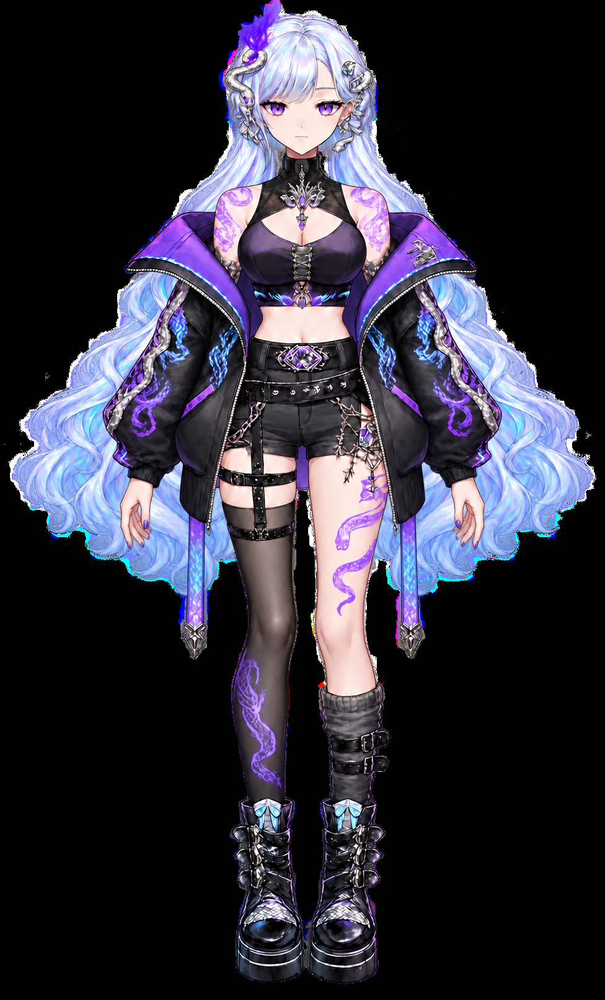

# 류시하 머리카락 애니메이션 초안

**가로형 레퍼런스 모션 · AE 편집용 JSX: [Reference Motion v3](./reference_motion_v3/README.md)** — [전체 ZIP](./reference_motion_v3/Reference_Motion_v3_Package.zip?raw=true) · [JSX](./reference_motion_v3/Build_Reference_Motion_v3.jsx?raw=true) · [영상](./reference_motion_v3/character_reference_v3.mp4?raw=true). 상반신 확대·카메라·그래픽 편집이 가능하며, 몸·머리카락의 세부 변형은 투명 영상에 렌더링되어 있습니다.

**최신 v8 검토본: [레퍼런스 초반의 안정적인 대기 모션](./v8/README.md)** — [미리보기](./v8/Natural_Motion_v8_Preview.mp4?raw=true) · [필수 ZIP 1](./v8/Ryusiha_Natural_Motion_v8_Package.zip?raw=true) · [필수 ZIP 2](./v8/Ryusiha_Natural_Motion_v8_Media2.zip?raw=true). 관절 제약 메시 기반 12초 구성입니다. 실제 AE 렌더링은 미검증입니다.

**이전 v7 검토본: [이미지 보정·하체 형태 고정](./v7/README.md)** — [필수 ZIP 1](./v7/Ryusiha_Natural_Motion_v7_Package.zip?raw=true) · [필수 ZIP 2](./v7/Ryusiha_Natural_Motion_v7_Media2.zip?raw=true) · [v6·v7 비교](./v7/V6_V7_Comparison.mp4?raw=true). 보호된 하체 픽셀의 480프레임 동일성을 검사했습니다. 실제 AE 렌더링은 미검증입니다.

**이전 v6 검토본: [다리·부츠의 옆 늘어짐 수정](./v6/README.md)** — [필수 ZIP 1](./v6/Ryusiha_Natural_Motion_v6_Package.zip?raw=true) · [필수 ZIP 2](./v6/Ryusiha_Natural_Motion_v6_Media2.zip?raw=true) · [v5·v6 비교](./v6/V5_V6_Comparison.mp4?raw=true). 실제 AE 렌더링은 미검증입니다.

**이전 v5 검토본: [어깨·배 연결부 수정](./v5/README.md)** — [필수 ZIP 1](./v5/Ryusiha_Natural_Motion_v5_Package.zip?raw=true) · [필수 ZIP 2](./v5/Ryusiha_Natural_Motion_v5_Media2.zip?raw=true) · [연결부 확대 영상](./v5/Shoulder_Waist_v5.mp4?raw=true). 실제 AE 렌더링은 미검증입니다.

**이전 v4 검토본: [16초 · 동작 확대](./v4/README.md)** — [전체 ZIP](./v4/Ryusiha_Natural_Motion_v4_Package.zip?raw=true) · [전신 미리보기](./v4/Natural_Motion_v4_Preview.mp4?raw=true) · [v3·v4 비교](./v4/V3_V4_Comparison.mp4?raw=true). 실제 AE 렌더링은 미검증입니다.

**이전 v3 검토본: [깜빡임·몸·팔 대기 모션 수정](./v3/README.md)** — [전체 ZIP](./v3/Ryusiha_Natural_Motion_v3_Package.zip?raw=true) · [전신 미리보기](./v3/Natural_Motion_v3_Preview.mp4?raw=true) · [눈·상체 확대](./v3/Face_and_Shoulders_v3.mp4?raw=true). 실제 AE 렌더링은 미검증입니다.

**이전 수정본: [자연스러운 대기 모션 v2](./v2/README.md)** — 팔·고개·상체·눈 깜빡임을 추가하고 머리카락 효과의 여백과 변형 축을 수정했습니다. [v2 전체 ZIP 다운로드](./v2/Ryusiha_Natural_Motion_v2_Package.zip?raw=true).

아래는 이전 v1 파일과 안내입니다.

몸과 얼굴을 고정하고 좌우 긴 머리카락을 따로 움직이기 위한 PSD 파츠와 After Effects 자동 구성 스크립트입니다.

## 다운로드

- [전체 작업 파일 ZIP](./Ryusiha_Hair_Draft_Package.zip?raw=true)
- [레이어형 PSD](./Ryusiha_Hair_Draft.psd?raw=true)
- [8초 움직임 미리보기 MP4](./Hair_Motion_Preview.mp4?raw=true)
- [After Effects 스크립트](./Build_Hair_Motion.jsx?raw=true)
- [자세한 사용 안내](./README_KO.txt)

## After Effects에서 실행

1. ZIP을 다운로드하고 압축을 풉니다.
2. `Build_Hair_Motion.jsx`와 `assets` 폴더를 같은 폴더에 둡니다.
3. After Effects에서 **파일 → 스크립트 → 스크립트 파일 실행**으로 JSX를 실행합니다.
4. 생성된 `RYUSIHA_HAIR_8s` 컴포지션을 재생합니다.
5. `HAIR_CONTROLS`의 `Hair strength`로 움직임을 조절하고 AEP로 저장합니다.

스크립트는 AE에 포함되는 Cycore의 `CC Bend It` 효과를 사용합니다. 제공된 MP4는 FFmpeg로 만든 움직임 시안이며, AE 스크립트의 렌더링 결과와 완전히 동일하지 않습니다.

## PSD 레이어

| 레이어 | 용도 |
| --- | --- |
| `BODY_BASE_fixed` | 긴 머리카락을 제외한 고정 몸 |
| `HAIR_L_screen_left` | 화면 왼쪽 긴 머리카락 |
| `HAIR_R_screen_right` | 화면 오른쪽 긴 머리카락 |
| `ORIGINAL_REFERENCE_hidden` | 비교용 원본, 기본적으로 숨김 |

## 검증 및 제한

- PSD를 다시 열어 4개 레이어의 배치와 가시성을 확인했습니다. 비교용 원본 레이어의 픽셀은 보존했습니다.
- 미리보기 영상은 488×806, 30fps, 8초, 240프레임으로 출력했습니다.
- AE 스크립트의 문법은 검사했지만 실제 After Effects 실행과 렌더링은 검증하지 못했습니다.
- 원본은 단일 레이어 PSD였으며, 파츠에는 AI 편집과 가려진 부분 복원이 포함되어 있습니다. 머리 결·실루엣과 일부 세부 묘사가 원본과 다릅니다.
- 가장자리의 밝은색·유색 잔여물은 추가 마스크 보정이 필요합니다.
- 앞머리·눈·입·몸의 리깅은 포함하지 않았습니다. 완성된 Live2D 모델이 아닙니다.
