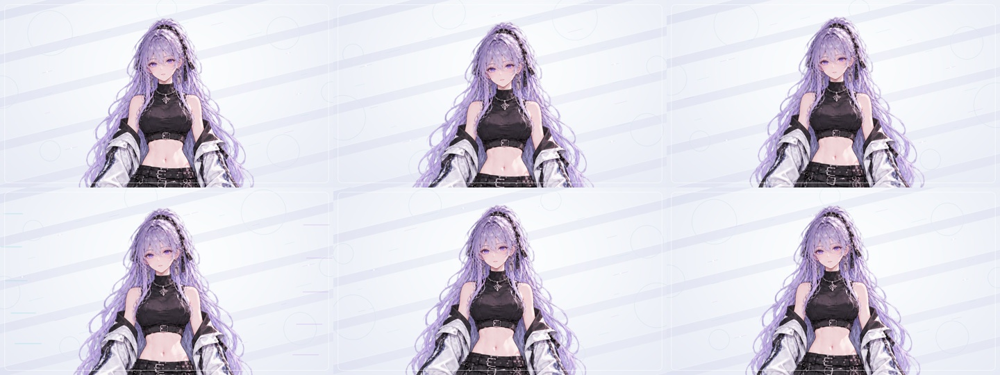

# 레퍼런스 반영 모션그래픽 v2

[완성 영상](./character_reference_v2.mp4?raw=true) · [영상·제작 파일 ZIP](./character_reference_v2_package.zip?raw=true)

1920×1080, 30fps, 10초, H.264, 무음 반복 영상입니다. 제공된 약 9.95초 레퍼런스에서 상반신 확대 구도, 카메라 이동·기울기, 머리카락의 시간차 흔들림, 밝은 배경과 청록·보라 계열의 빛 효과를 참고했습니다. 레퍼런스 영상과 음원은 저장소에 포함하지 않았습니다.



## 파일

- `character_reference_v2.mp4`: 완성 영상.
- `render_reference_motion.py`: 원본 그림을 연속 메쉬로 변형하고 카메라·배경 효과를 합성하는 제작 스크립트.
- `validate_video.py`, `validation.json`: 전체 프레임 디코딩, 영상 규격, 반복 연결 구간 검사와 결과.
- `character_reference_v2_package.zip`: 영상, 스크립트, 안내, 대표 프레임, 검증 결과. 제공받은 원본 PSD는 저장소와 ZIP에 포함하지 않았습니다.

## 재현

Python 3와 Pillow, NumPy, SciPy 및 `ffmpeg`, `ffprobe`가 필요합니다. 이 폴더에서 실행합니다.

```sh
python3 render_reference_motion.py --source '/원본/캐릭터.psd' --output ./rendered
cp validate_video.py ./rendered/
python3 ./rendered/validate_video.py
```

## 검증과 제한

전체 300프레임 디코딩, 1920×1080·30fps·10초 규격 및 반복 연결 구간의 픽셀 차이 검사를 통과했습니다. 픽셀 차이 검사는 시각적 품질 전체를 보증하지 않습니다.

파츠 PSD는 파츠들이 한 화면에 배치된 단일 그림 레이어이며, 개별 파츠로 분리된 리깅 구조가 아닙니다. 이 영상은 원본 자세를 유지한 연속 이미지 변형입니다. 레퍼런스의 팔 뻗기, 입 모양과 시선 변화는 포함하지 않았습니다. 원본의 흰색 가장자리 픽셀은 유지됩니다. After Effects 프로젝트나 Live2D 모델은 포함하지 않습니다.
