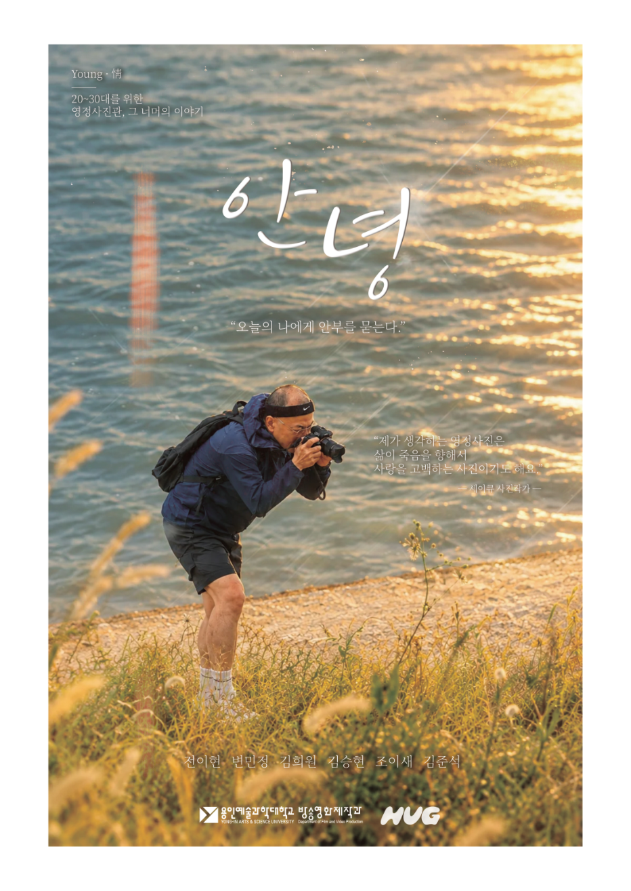

# 안녕 포스터 — 730 × 1030mm

- [**인쇄용 PDF 다운로드**](https://github.com/goldban/project/raw/refs/heads/main/design/annyeong_730x1030/ANNYEONG_730x1030_PRINT.pdf)
- [**16비트 CMYK·원본 레이어 유지 PSD 다운로드 페이지**](https://github.com/goldban/project/blob/main/design/annyeong_730x1030/ANNYEONG_730x1030_LAYERED_16BIT_CMYK.psd)
- [**전체 미리보기**](pdf_page_preview.png)

PSD는 약 1.3GB이므로 Git LFS로 저장했습니다. 위 PSD 페이지에서 **Download raw / 다운로드 버튼**을 사용하세요. 저장소를 Git으로 받는 경우에는 Git LFS가 필요합니다. 용량이 작은 파일부터 확인하려면 약 40MB의 PDF를 사용하세요.

## 규격과 보존 내용

요청한 크기는 **가로 730 × 세로 1030mm**입니다.

원본 PSD는 8268 × 11811px, 300ppi, 약 700 × 1000mm의 세로형 문서였습니다. 사용자가 선택한 전체 보존 방식에 따라 원본 캔버스를 비율대로 확대해 높이를 1030mm에 맞춘 뒤 좌우에 약 **4.49mm씩** 배경을 연장했습니다. 원본이 이미 흰 여백을 포함한 포스터이므로 추가되는 부분도 같은 흰 배경입니다. 제목·인물·소개·크레디트를 잘라내지 않았습니다.

- 출력 픽셀: **8760 × 12360px**.
- PSD 해상도: **304.8ppi**.
- PSD: 원본 **16비트 CMYK**, 원래의 **이미지 레이어 2개**와 ICC 프로파일 유지.
- 원본부터 텍스트가 이미지에 합쳐져 있었으며, 이번 수정으로 글자별 텍스트 레이어가 만들어진 것은 아닙니다.
- 원본의 약 700×1000mm 전체 흰 여백도 보존한 구성입니다. 사진 부분만 730×1030mm로 잘라 채운 버전이 아닙니다.
- 별도 도련은 추가하지 않았습니다. 최종 제작소의 도련 요구가 있으면 그 규격에 따라 추가해야 합니다.

## 인쇄용 PDF

PDF의 실제 페이지를 **730 × 1030mm**로 설정했습니다. 8760 × 12360px 이미지가 페이지에 정확히 맞게 배치되어 있습니다. PDF는 인쇄용 8비트 CMYK JPEG(품질 97)와 원본 CMYK ICC 프로파일을 포함합니다. PDF/X 인증을 주장하지 않습니다.

인쇄 대화상자에서는 임의의 용지 맞춤 축소 대신 **실제 크기 / 100%**와 제작소의 출력 기준을 사용하세요. 원본의 16비트 데이터가 필요한 편집은 PSD를 사용하면 됩니다.

## 검증

PSD를 다시 열어 크기(오차 0.001mm 미만), CMYK·16비트, 레이어 2개, 원본 ICC 일치를 확인했습니다. 병합 캐시의 4개 채널이 배치된 이미지 레이어와 일치하고, 추가된 테두리는 CMYK 흰색임을 확인했습니다.

PDF는 별도 PDF 도구로 다시 열어 실제 페이지 크기와 ICC 기반 이미지 색상 공간을 확인하고 페이지를 렌더링했습니다. **Adobe Photoshop 자체 실행은 미검증**입니다. 원본 PSD와 별개인 새 파일로 저장했습니다.
