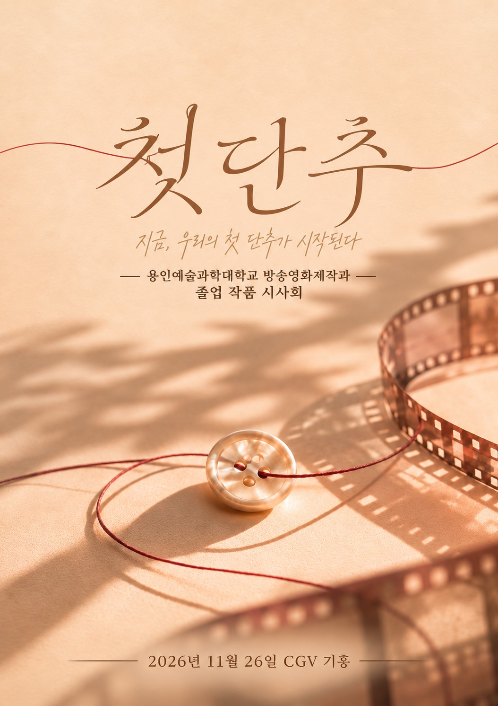

# 첫단추 — 세로형 PPT 표지

[**PPT 다운로드**](https://github.com/goldban/project/raw/refs/heads/main/design/first_button_ppt/First_Button_Cover.pptx)

첨부 이미지를 참고해 분위기와 문구를 재구성한 세로형 표지 1장입니다. 원본 이미지를 픽셀 단위로 그대로 삽입한 파일은 아닙니다. 배경과 글자는 하나의 이미지로 들어 있으므로 글자별 편집은 불가능합니다. 그림을 선택해 우클릭 → 그림 변경으로 교체할 수 있습니다.

이미지 비율을 유지해 표지 전체를 채웠고 잘라내지 않았습니다. 배경에 작품명·학과·시사회·날짜와 장소가 포함되어 있습니다. PowerPoint에서 새 텍스트 상자를 추가할 수 있습니다.

PPTX를 다시 열어 1개 슬라이드, 이미지 크기·위치와 포함 이미지 데이터, ZIP 무결성을 확인했습니다. 실제 Microsoft PowerPoint 실행은 미검증입니다.
