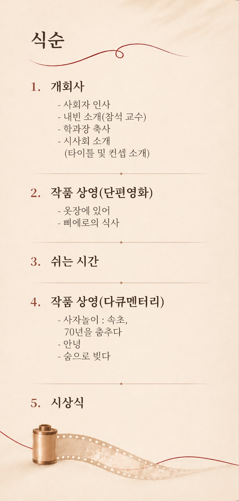
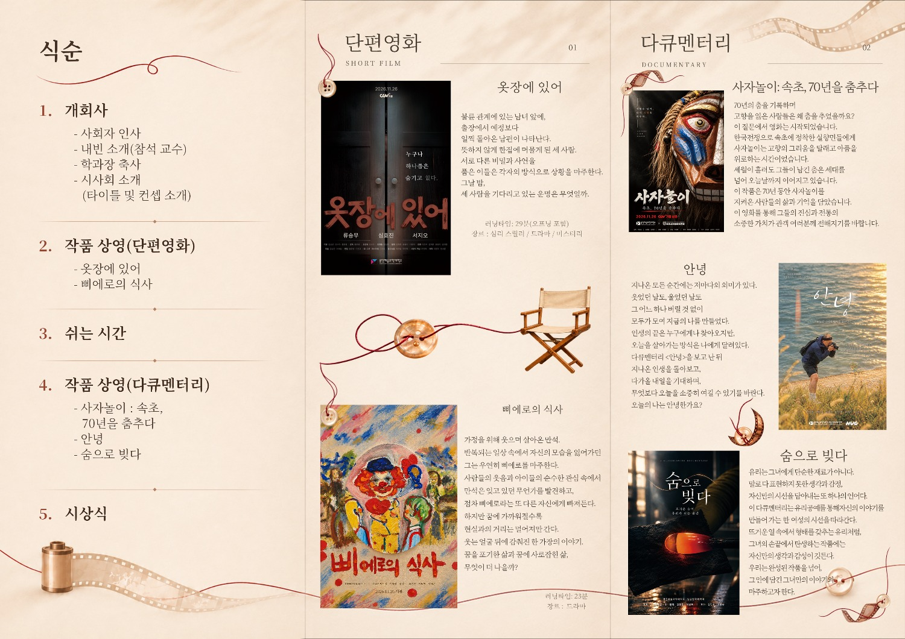

# 안쪽면 식순 — 글꼴·크기·행간·정렬 통일

**최신 첨부 이미지의 핑크 접지선 84·171mm에 맞춘 안쪽면은 [접지선 맞춤 수정본](../inside_fold_aligned)에 있습니다.**

- [**수정 PSD 다운로드 — 이미지형**](https://github.com/goldban/project/raw/refs/heads/main/design/inside_schedule_clean/INSIDE_SCHEDULE_CLEAN_FLAT.psd)
- [**완성 TIFF 다운로드**](https://github.com/goldban/project/raw/refs/heads/main/design/inside_schedule_clean/INSIDE_SCHEDULE_CLEAN.tif)
- [**식순 글자 편집용 Photoshop 생성 패키지**](https://github.com/goldban/project/raw/refs/heads/main/design/inside_schedule_clean/Editable_Schedule_Package.zip)

## 정리한 내용

왼쪽 식순 면을 Noto Serif CJK KR 한 계열로 통일했습니다. 제목과 항목명은 Bold, 본문은 Regular로 두께만 구분했습니다.

- 제목 88px / 항목명·번호 58px / 본문 46px.
- 본문 기준선 간격 60px로 통일.
- 번호 x=150px, 항목명 x=250px, 본문 x=285px, 이어지는 줄 x=318px.
- 긴 시사회 소개 문구와 사자놀이 제목은 두 줄로 정리.
- 다큐멘터리 마지막 문구와 아래 구분선 사이에 여백 확보.
- 붉은 실과 하단 필름 장식은 배경으로 재구성했으며, 네 구분선의 위치와 길이를 다시 정리.
- 나머지 두 면의 작품 소개 내용은 그대로 유지.

식순 문구의 순서와 내용은 유지했습니다. 다큐멘터리 제목은 `사자놀이 : 속초, 70년을 춤추다`, `안녕`, `숨으로 빚다`입니다.

## 파일 열기와 편집

이전 외부 생성 편집용 PSD에서 Photoshop 오류가 반복 보고되어, 이번 완성 PSD는 **복잡한 텍스트·스마트 오브젝트·효과 데이터가 없는 기본 8비트 RGB 단일 이미지 PSD**로 만들었습니다. 완성 TIFF도 제공합니다. 이 두 완성 파일은 글자별 수정이 불가능합니다.

글자를 편집하려면 다음 순서로 Photoshop 자체 문서를 생성하세요.

1. `Editable_Schedule_Package.zip`을 다운로드해 별도 일반 폴더에 압축을 풉니다.
2. 제공한 Regular·Bold OTF 두 파일을 설치하고 Photoshop을 다시 실행합니다.
3. **파일 → 스크립트 → 찾아보기**에서 `Build_Editable_Schedule.jsx`를 실행합니다.
4. Photoshop이 배경 TIFF를 열고 식순의 **22개 텍스트 요소와 구분선 4개 레이어**를 생성합니다. 저장 창에서 새 PSD 이름을 지정하세요.

식순 제목·번호·항목명·본문 전체가 실제 Photoshop 텍스트로 생성되는 방식입니다. 다른 두 면은 TIFF 배경에 합쳐져 있어 이 생성본에서 글자별 편집 대상이 아닙니다. 구분선은 별도의 이미지 레이어로 이동할 수 있습니다. 1px 밝은 획 생성이 Photoshop 버전 차이로 실패하면 안내가 나오며, 레이어 스타일에서 직접 적용할 수 있습니다.

`INSIDE_BASE_NO_SCHEDULE.tif`는 스크립트용 빈 식순 배경입니다. 그 파일 자체를 최종 인쇄물로 사용하지 마세요. 최종 인쇄 이미지 이름은 `INSIDE_SCHEDULE_CLEAN.tif`입니다.

## 규격과 검증

기존 3508 × 2480px, 약 258 × 182.395mm, 87 / 87 / 84mm 및 가이드 87·174mm를 유지했습니다. [기존 양면 반전 확인](../leaflet_pair_same_folds/mirrored_registration_check.png)의 인쇄 배치 주의사항도 유지됩니다. 별도 도련은 추가하지 않았습니다.

글자 영역이 안전 여백 안에 들어가는지, 같은 글꼴 계열과 정해진 크기가 사용되는지 확인했습니다. 단순 PSD와 TIFF를 다시 열어 완성 이미지와 픽셀 일치를 확인했습니다. ImageMagick에서도 PSD를 열었고 JSX 문법도 검사했습니다. **Adobe Photoshop에서 파일 열기나 스크립트 실행 자체는 미검증**입니다.

