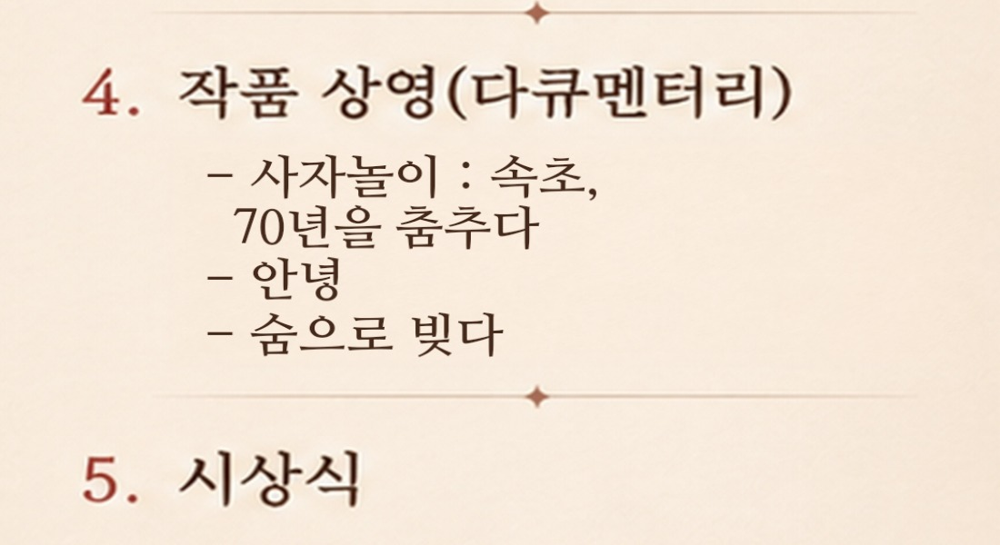
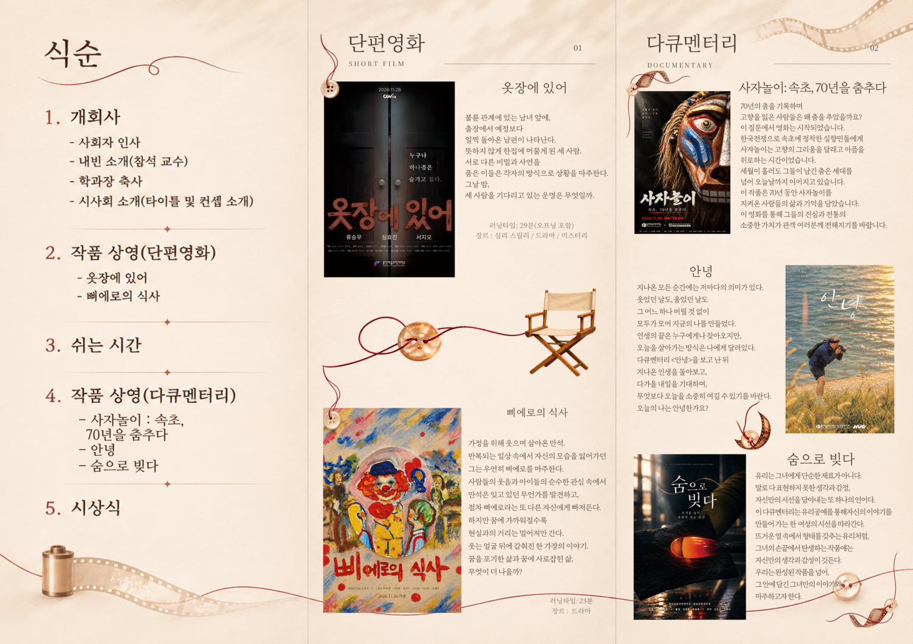

# 안쪽면 식순 — 다큐멘터리 제목 수정

- [**편집용 PSD 다운로드**](https://github.com/goldban/project/raw/refs/heads/main/design/inside_titles_corrected/INSIDE_TITLES_CORRECTED_EDITABLE.psd)
- [단순 호환 PSD 다운로드](https://github.com/goldban/project/raw/refs/heads/main/design/inside_titles_corrected/INSIDE_TITLES_CORRECTED_SIMPLE.psd)
- [TIFF 다운로드](https://github.com/goldban/project/raw/refs/heads/main/design/inside_titles_corrected/INSIDE_TITLES_CORRECTED.tif)
- [새 목록 텍스트 편집용 글꼴 다운로드](https://github.com/goldban/project/raw/refs/heads/main/design/inside_titles_corrected/NanumMyeongjo-Bold.ttf)

## 수정한 목록

1. 사자놀이 : 속초, 70년을 춤추다
2. 안녕
3. 숨으로 빚다

사용자가 첨부한 식순의 다큐멘터리 목록 영역만 수정했습니다. 첫 제목은 칸 안에 들어가도록 두 줄로 배치했습니다. 기존에 배경 이미지에 합쳐진 잘못된 목록은 배경 보정 이미지 레이어로 가렸고, 세 항목을 실제 텍스트 레이어로 새로 만들었습니다. 새 목록은 비슷한 계열의 공개 글꼴 **나눔명조 Bold**로 구성했으며, 원본 이미지 속 글자 모양과 픽셀 단위로 동일한 서체는 아닙니다.

새로 추가된 `EDIT LIST 1`, `EDIT LIST 2`, `EDIT LIST 3`은 글자 도구로 편집할 수 있습니다. 이를 편집할 때는 제공한 TTF를 설치한 뒤 Photoshop을 다시 실행하세요. 원본 기존 텍스트 25개도 유지되어 편집용 PSD에는 텍스트 레이어가 총 28개입니다. 원래 원고의 오른쪽 작품 소개 영역은 이번 목록 수정 범위에 포함하지 않았습니다.

3508 × 2480px, 가로 258mm, 세로 약 182.395mm, 칸 폭 87 / 87 / 84mm 및 가이드 87·174mm를 유지했습니다. 양면 인쇄 배치에 관한 [기존 반전 확인 시안](../leaflet_pair_same_folds/mirrored_registration_check.png)은 계속 적용됩니다.

## 열기와 편집

편집용 PSD가 열리지 않으면 단순 PSD 또는 TIFF를 사용하세요. **단순 PSD는 각 칸이 이미지 레이어여서 글자별 수정은 불가능**합니다. TIFF도 단일 합성 이미지입니다. 모든 파일은 ZIP 없이 다운로드할 수 있습니다.

PSD 재열기, 세 항목의 정확한 문자열, 글꼴 PostScript 이름과 접지 좌표를 확인했습니다. 단순 PSD는 psd-tools·Pillow로 픽셀 일치를 검증했고 ImageMagick에서도 PSD 열기를 확인했습니다. Adobe Photoshop 자체 실행은 미검증입니다.

## 전체 미리보기

