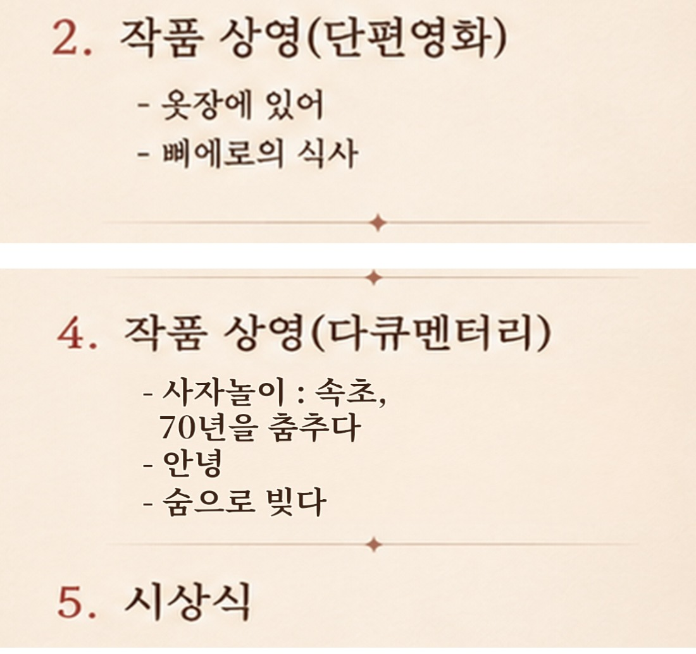
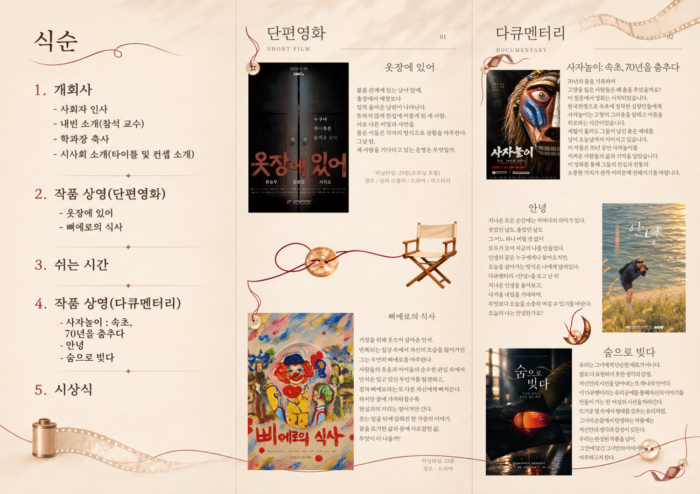

# 다큐멘터리 목록 — 참고 글자 스타일에 맞춘 수정본

- [**편집용 PSD 다운로드**](https://github.com/goldban/project/raw/refs/heads/main/design/inside_titles_font_match/INSIDE_FONT_MATCH_EDITABLE.psd)
- [단순 호환 PSD 다운로드](https://github.com/goldban/project/raw/refs/heads/main/design/inside_titles_font_match/INSIDE_FONT_MATCH_SIMPLE.psd)
- [TIFF 다운로드](https://github.com/goldban/project/raw/refs/heads/main/design/inside_titles_font_match/INSIDE_FONT_MATCH.tif)
- [편집용 글꼴 다운로드 — Noto Serif CJK KR Bold](https://github.com/goldban/project/raw/refs/heads/main/design/inside_titles_font_match/NotoSerifCJKkr-Bold.otf)

## 적용한 스타일

참고 이미지의 기존 단편영화 목록처럼 **굵은 명조체, 짙은 갈색 글씨, 흰 테두리**로 다큐멘터리 목록을 다시 구성했습니다. Noto Serif CJK KR Bold 48px와 바깥쪽 2px의 밝은 테두리를 적용했습니다. 세 항목은 네이티브 텍스트 레이어이며 흰 테두리는 네이티브 레이어 효과입니다. 원본 이미지 속 글꼴의 이름은 확인할 수 없으므로 **원본과 정확히 같은 글꼴이라고 보장하지는 않습니다.** 비교 시안에서 모양을 확인해 주세요.

문구는 그대로 유지했습니다.

1. 사자놀이 : 속초, 70년을 춤추다
2. 안녕
3. 숨으로 빚다

첫 항목은 긴 제목이 칸을 넘지 않게 두 줄로 배치했습니다. 식순의 나머지 제목, 문구와 전체 규격은 바꾸지 않았습니다.

## Photoshop에서 수정

제공한 `NotoSerifCJKkr-Bold.otf`를 설치한 뒤 Photoshop을 다시 실행하고 편집용 PSD를 여세요. `EDIT LIST 1`부터 `EDIT LIST 3`까지는 글자 도구로 수정할 수 있습니다. 해당 레이어의 획 효과를 조절하면 흰 테두리 두께를 바꿀 수 있습니다. 기존 25개 텍스트 레이어도 유지했습니다.

편집용 파일이 열리지 않으면 단순 PSD나 TIFF를 사용하세요. 단순 PSD는 이미지 레이어 3개이므로 글자별 수정은 할 수 없습니다. 모든 파일은 압축 해제 없이 받을 수 있습니다. 글꼴은 SIL Open Font License에 따라 제공하며 라이선스를 동봉했습니다.

3508 × 2480px, 가로 258mm, 세로 약 182.395mm, 칸 폭 87 / 87 / 84mm, 접지 가이드 87·174mm를 유지했습니다. [기존 양면 반전 확인 시안](../leaflet_pair_same_folds/mirrored_registration_check.png)의 인쇄 배치 주의사항은 계속 적용됩니다.

## 검증

PSD 재열기, 세 제목 문자열, 실제 글꼴명, 글자 크기와 흰 획 효과를 확인했습니다. 단순 PSD는 픽셀 일치를 검사했고 ImageMagick에서도 파일을 열었습니다. Adobe Photoshop 자체 실행은 미검증입니다.

