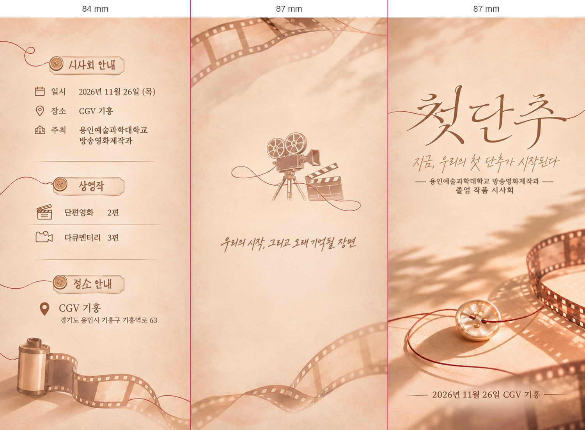

# 팜플렛 뒷면 — 84 / 87 / 87mm 수정본

[**수정 PSD 바로 다운로드**](https://github.com/goldban/project/raw/refs/heads/main/design/leaflet_back_84_87_87/BACK_84-87-87_EDITABLE.psd) · [**전체 ZIP 다운로드**](https://github.com/goldban/project/raw/refs/heads/main/design/leaflet_back_84_87_87/Back_84-87-87_Package.zip) · [**단일 합성 TIFF**](https://github.com/goldban/project/raw/refs/heads/main/design/leaflet_back_84_87_87/BACK_84-87-87_flat.tif)

## 규격과 디자인

- 사용자가 새로 첨부한 `팜플렛 뒷면.psd`를 수정했습니다.
- 왼쪽부터 **84 / 87 / 87mm**, 가로 합계 **258mm**입니다. 이전 겉면의 87 / 87 / 84mm 방향을 사용하지 않았습니다.
- 접지 가이드는 왼쪽 끝에서 **84mm, 171mm**입니다.
- 링크로 지정한 안쪽면 PSD와 전체 문서의 픽셀 크기와 인쇄 크기를 맞췄습니다: **3508 × 2480px, 약 258 × 182.395mm**.
- 각 칸의 기존 디자인을 새 폭에 맞춰 비례 조정했습니다. 가는 기존 경계선 픽셀은 제외했습니다. 제목·문구를 새 서체로 바꾸거나 그림을 생성하지 않았습니다.
- 별도 도련은 추가하지 않았습니다. 최종 인쇄소의 세로·도련 규격은 확인이 필요합니다.

핑크 선이 있는 JPG는 확인용입니다. PSD 가이드는 인쇄되지 않습니다.

## 편집 가능한 범위

기존 **텍스트 레이어 4개(표시 3개, 숨김 1개)**와 **스마트 오브젝트 2개** 및 그 내부 원본 PNG 데이터를 유지했습니다. 배경은 각 칸의 폭에 맞춰 3개 이미지 레이어로 나눴고 나머지 보정 레이어도 새 좌표에 맞춰 배치했습니다. 총 14개 레이어입니다.

원본부터 배경에 합쳐져 있던 제목·그림·본문까지 모두 텍스트로 바뀐 것은 아닙니다. 합성 이미지 부분은 글자 도구로 직접 수정할 수 없습니다.

원본 글꼴 `Griun_Simsimche-Rg`, `HancomUljuBangudaePetroglyph` 설정을 유지했습니다. 글꼴 파일은 포함하지 않았습니다. 텍스트를 편집할 때는 해당 글꼴이 설치되어 있어야 원래 서체가 유지됩니다. 숨김 문구 레이어는 계속 숨김 상태입니다.

`original_uploaded.psd`는 새로 첨부한 원본을 그대로 보관한 파일입니다. TIFF는 레이어 없는 대체 이미지입니다. ZIP은 분할하지 않은 일반 ZIP입니다.

## 검증

ag-psd와 psd-tools로 PSD를 다시 열어 크기, 14개 레이어, 4개 텍스트, 2개 스마트 오브젝트, 내부 데이터와 가이드 좌표를 확인했습니다. 합성 화면과 TIFF의 픽셀 일치를 확인했고 ImageMagick에서도 열기를 확인했습니다. **Adobe Photoshop 자체 실행은 미검증**입니다.

원본은 1491 × 1055px입니다. 지정한 문서 크기에 맞춰 확대했으며, 출력 픽셀 수가 늘어난 것이 원본 그림의 세부 묘사를 추가한 것은 아닙니다. 색상은 원본처럼 RGB를 유지했습니다.
