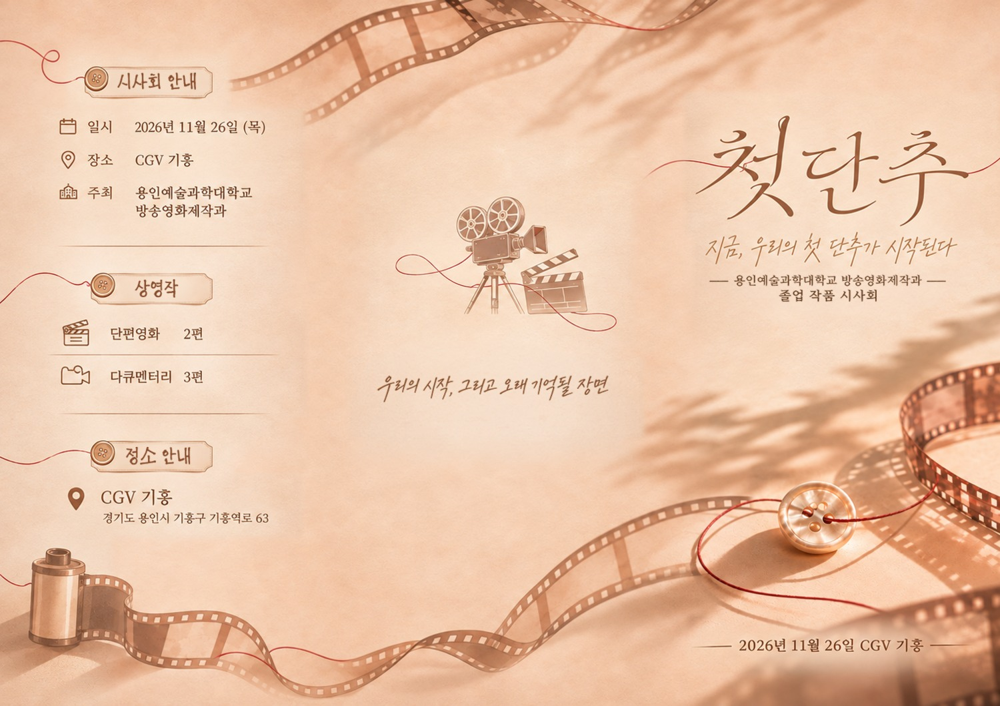

# 리플렛 뒷면 — 배경 연결 수정본

[**수정 PSD 다운로드**](https://github.com/goldban/project/raw/refs/heads/main/design/leaflet_background_continuous/BACK_84-87-87_CONTINUOUS.psd) · [**전체 ZIP**](https://github.com/goldban/project/raw/refs/heads/main/design/leaflet_background_continuous/Continuous_Background_Package.zip) · [**TIFF 대체 파일**](https://github.com/goldban/project/raw/refs/heads/main/design/leaflet_background_continuous/BACK_84-87-87_CONTINUOUS_flat.tif)

## 수정 내용

- 84 / 87 / 87mm, 가로 258mm, 3508 × 2480px 규격을 유지했습니다.
- 접지 가이드 84mm, 171mm는 그대로입니다.
- 두 접지 경계의 종이 질감·색감·그림자를 연결했습니다.
- 상단 필름의 갑작스러운 잘림을 다듬고, 하단 필름을 좌측 필름통에서 가운데를 거쳐 우측 필름으로 이어지는 흐름으로 보정했습니다.
- 배경 연결 부분은 원본을 참고한 이미지 보정으로 재구성한 영역입니다.
- 주요 글자·카메라·단추 등 보호 영역은 이전 수정본의 픽셀을 유지했습니다. 기존 텍스트 내용과 배치, 스마트 오브젝트 데이터는 변경하지 않았습니다.

## Photoshop에서 수정

`BACKGROUND continuity retouch - toggle to compare`가 새로 추가된 배경 보정 레이어입니다. 이 레이어의 눈 아이콘을 끄면 이전 상태와 비교할 수 있습니다. 배경 보정은 투명 이미지 레이어이며 필름 조각별 벡터 편집 구조는 아닙니다.

기존 텍스트 4개(표시 3개, 숨김 1개)와 스마트 오브젝트 2개를 유지했습니다. 총 15개 레이어입니다. 원본부터 배경에 합쳐져 있던 글자·그림은 개별 텍스트나 오브젝트로 분리하지 않았습니다. 원본 글꼴은 사용자 컴퓨터에 설치되어 있어야 기존 서체로 편집할 수 있습니다.

보정 전 PSD는 [이전 수정본 폴더](../leaflet_back_84_87_87)에 그대로 보관했습니다. ZIP은 분할 압축이 아닙니다.

## 검증

PSD 재열기와 합성 화면 일치, 기존 14개 레이어의 위치·표시 상태, 텍스트 내용·좌표, 스마트 오브젝트 내부 데이터, 접지 가이드 유지 여부를 검사했습니다. 주요 보호 영역 216,227개 표본 픽셀의 변경은 0개였습니다. ImageMagick에서도 열기를 확인했습니다. **Adobe Photoshop 자체 실행은 미검증**입니다.

픽셀 크기와 세로 비율, RGB 색상, 기존 인쇄 조건은 유지했으며 도련은 추가하지 않았습니다. TIFF는 편집 레이어 없는 단일 합성 이미지입니다.
