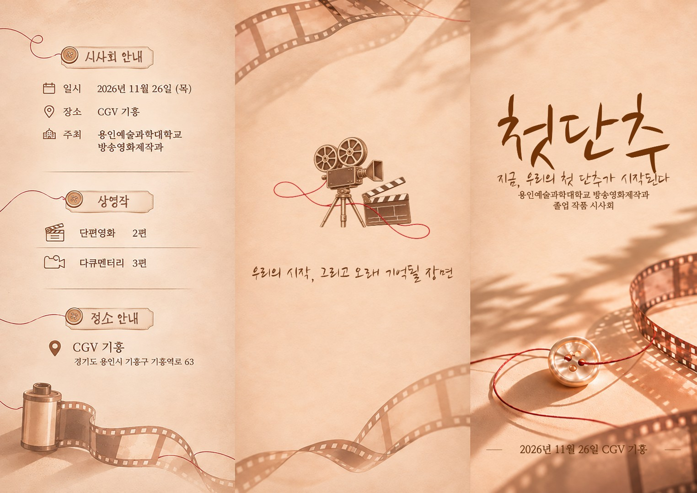

# 리플렛 겉면 — 가운데 정렬 · 편집 가능한 수정본

[**PSD 바로 다운로드**](https://github.com/goldban/project/raw/refs/heads/main/design/leaflet_centered_editable/OUTSIDE_centered_EDITABLE.psd) · [**글꼴·PSD·Photoshop 스크립트 전체 ZIP**](https://github.com/goldban/project/raw/refs/heads/main/design/leaflet_centered_editable/Centered_Editable_Package.zip)

## 수정 내용

- 겉면 가로 258mm, 왼쪽부터 87 / 87 / 84mm 기준입니다.
- 가운데 면의 카메라·문구, 오른쪽 표지의 제목·슬로건·학교명·행사명·일시를 각 면 중심에 맞췄습니다.
- 원본은 레이어가 없는 합성 이미지였습니다. 제목, 중간 문구, 슬로건, 학교명, 행사명, 일시를 **실제 Photoshop 텍스트 레이어 6개**로 다시 만들었습니다.
- 원본 서체를 분리할 수 없어 비슷한 공개 글꼴로 재구성했습니다. 원본과 글자 모양이 동일하지 않습니다.
- 카메라와 배경은 원본을 참고해 재구성했습니다. 카메라는 별도로 이동할 수 있습니다. 필름·단추·종이 질감은 배경 이미지에 포함되어 있습니다.
- 왼쪽 안내 면은 원본 이미지 상태이며 글자별 편집 레이어로 재구성하지 않았습니다. 면 전체를 이동·교체할 수 있습니다.
- 원본 전체 이미지를 숨김 레이어에 보존했습니다.

## Photoshop에서 수정하기

1. 전체 ZIP을 일반 폴더로 압축 해제합니다.
2. `fonts` 안의 두 TTF 파일을 설치한 뒤 Photoshop을 다시 실행하세요. 공개 글꼴의 라이선스도 함께 포함했습니다.
3. `OUTSIDE_centered_EDITABLE.psd`를 엽니다. 텍스트 업데이트 안내가 나오면 **업데이트**를 선택합니다.
4. `04 EDIT`부터 `09 EDIT`까지는 글자 도구로 수정할 수 있습니다. `03 CAMERA`는 이동 도구로 움직일 수 있습니다.
5. 접지 가이드는 보기 → 표시 → 안내선에서 확인하세요. 가이드는 인쇄되지 않습니다.

원본을 자동 변환한 편집 레이어가 아니라 주요 문구를 다시 입력한 구성입니다. 글꼴이 없으면 모양이 달라질 수 있습니다.

## Photoshop 안에서 문서를 새로 생성하기

PSD 열기나 텍스트 갱신에 문제가 있으면 Photoshop의 **파일 → 스크립트 → 찾아보기**에서 `Build_Editable_In_Photoshop.jsx`를 실행하세요. `assets` 폴더와 JSX는 같은 상위 폴더 구조를 유지해야 합니다. 제공한 글꼴을 먼저 설치하세요. 배경·왼쪽 안내 이미지·카메라와 6개 텍스트 레이어를 Photoshop 자체 기능으로 생성하고 PSD 저장 창을 엽니다. JSX는 보조 재생성 경로이며 실제 Photoshop에서 실행 검증하지 않았습니다. 하단 양쪽 장식 선은 JSX 재생성본에 포함되지 않습니다.

## 검증과 인쇄 조건

PSD를 ag-psd와 psd-tools로 재열어 11개 레이어와 6개 네이티브 텍스트 내용·중앙 정렬 좌표를 확인했습니다. 합성 화면을 원래 렌더링과 비교했고 ImageMagick에서도 열기를 확인했습니다. Adobe Photoshop 자체 실행은 이 환경에서 검증하지 못했습니다.

원본 픽셀 크기 3047 × 2157px를 유지했습니다. 가로 258mm, 세로 약 182.64mm, 약 300ppi입니다. 세로 및 도련의 별도 인쇄소 규격은 받지 않아 도련을 추가하지 않았습니다. 색상은 RGB입니다. 인쇄소 최종 규격은 별도로 확인하세요.
