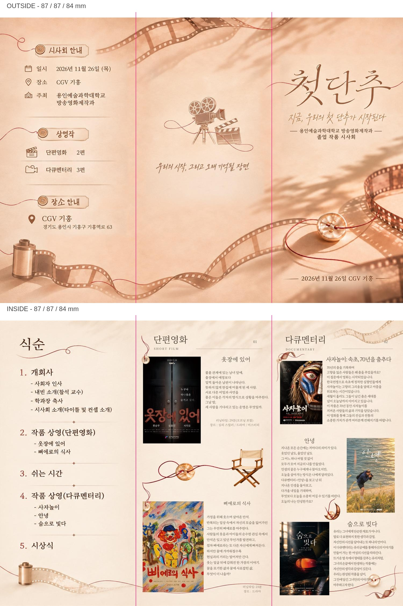
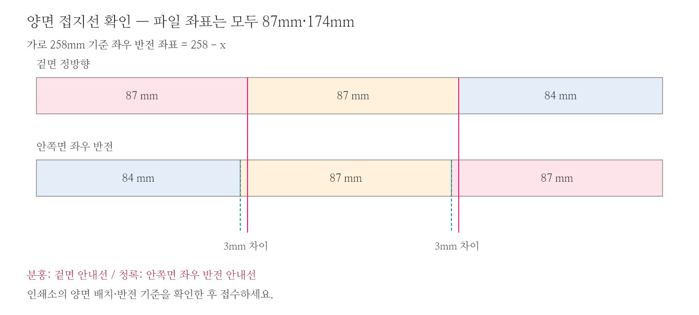

# 양면 리플렛 — 같은 접지 좌표로 통일한 요청 버전

## 다운로드

- [**겉면 PSD 다운로드**](https://github.com/goldban/project/raw/refs/heads/main/design/leaflet_pair_same_folds/OUTSIDE_87-87-84_SAME_FOLDS.psd)
- [**안쪽면 PSD 다운로드 — 일반 ZIP**](https://github.com/goldban/project/raw/refs/heads/main/design/leaflet_pair_same_folds/INSIDE_87-87-84_SAME_FOLDS.zip)
- [겉면 TIFF](https://github.com/goldban/project/raw/refs/heads/main/design/leaflet_pair_same_folds/outside_print.tif) · [안쪽면 TIFF](https://github.com/goldban/project/raw/refs/heads/main/design/leaflet_pair_same_folds/inside_print.tif)

안쪽면 PSD는 GitHub의 파일당 100MiB 제한 때문에 일반 ZIP 하나로 압축했습니다. **ZIP을 다운로드 폴더에 저장한 후 별도의 일반 폴더에 모두 압축 풀기를 하고 PSD를 여세요.** 분할 압축이 아닙니다. ZIP 내부를 압축 해제 대상으로 선택하지 마세요.

## 동일하게 맞춘 규격

| 구분 | 겉면 | 안쪽면 |
|---|---|---|
| 전체 크기 | 258 × 약 182.395mm | 258 × 약 182.395mm |
| 픽셀 크기 | 3508 × 2480px | 3508 × 2480px |
| 왼쪽부터 칸 폭 | 87 / 87 / 84mm | 87 / 87 / 84mm |
| 왼쪽부터 접지 가이드 | 87mm, 174mm | 87mm, 174mm |
| 색상 | 원본 CMYK 및 ICC 유지 | 원본 RGB 유지 |
| 텍스트 레이어 수 | 4개 | 50개 |
| 스마트 오브젝트 수 | 2개 | 2개 |

레이어의 텍스트 내용과 기존 글꼴을 유지하며 각 칸의 폭·캐시 이미지·텍스트 및 스마트 오브젝트 좌표를 조정했습니다. 안쪽면의 넓은 배경 스마트 오브젝트 1개는 칸별 폭을 조정하기 위해 이미지 레이어로 변경했습니다. 원본에서 이미 합쳐진 글자나 그림까지 모두 텍스트로 바꾼 것은 아닙니다. 원본은 [사용자가 공유한 Drive 폴더](https://drive.google.com/drive/folders/1YSISHw8Zz0IEkSi0qRTJUY4uI6TzXeOK)에 있습니다.

## 접지 확인용 시안 — 인쇄 파일이 아닙니다

## 실제 양면 반전 시 반드시 확인할 점

사용자가 선택한 2번 규격대로 **양면 모두 같은 좌표**로 제작했습니다. 다만 258mm 폭에서 실제 좌우 반전은 `x → 258 − x`이므로, 87·174mm는 반대면에서 **171·84mm**에 대응합니다. **양면에 같은 좌표를 넣는 것만으로 뒤집어 인쇄했을 때 접지선이 일치한다고 보장할 수 없습니다.** 좌우 반전 방식으로 대조하면 각 접지선에 3mm 차이가 있습니다.

이 시안을 인쇄소에 보여 주고 양면 배치 및 RIP 반전 기준에 맞는지 확인한 뒤 최종 접수하세요. 서로 다른 인쇄소의 회전·배치 방식까지 검증한 파일은 아닙니다.

## 검증과 제한

PSD 재열기, 양면 크기·해상도 일치, 접지 가이드 좌표, 네이티브 텍스트 개수, 스마트 오브젝트 내부 데이터와 ICC 유지 여부를 확인했습니다. 가이드 좌표는 파일 형식의 소수점 양자화 때문에 약 87.0005mm와 174.0011mm로 읽히며, 목표값과 차이는 0.005mm 미만입니다. TIFF의 색상 모드와 픽셀 일치를 검증했고 ImageMagick으로 PSD 합성 이미지를 열었습니다.

Adobe Photoshop 자체 실행은 미검증입니다. GIMP 네이티브 창 검증은 현재 디스플레이가 없어 실행하지 못했습니다. 인쇄소 지정 도련은 제공되지 않아 추가하지 않았습니다. 겉면/안쪽면의 원본 색상 모드는 서로 다르므로 최종 인쇄소의 색상 기준도 확인하세요.
